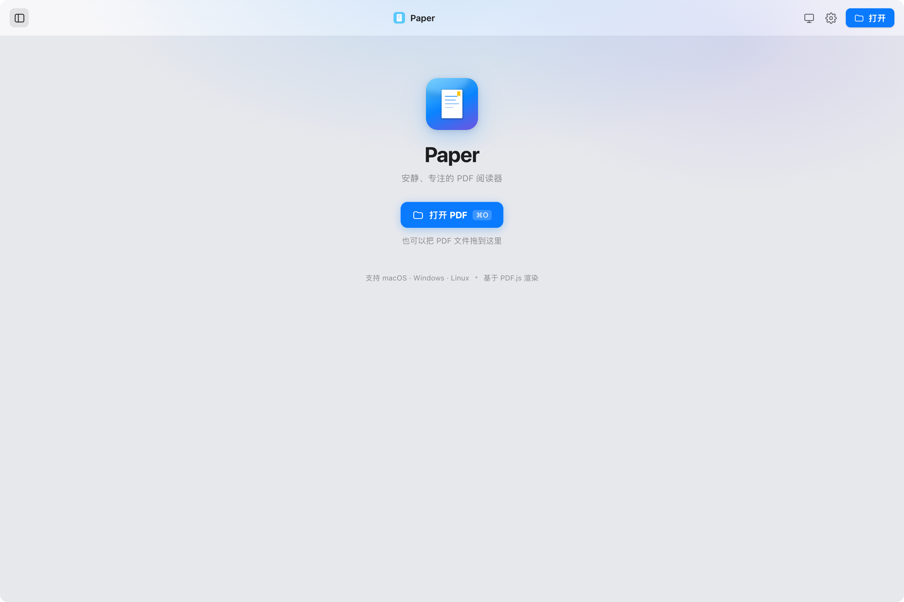
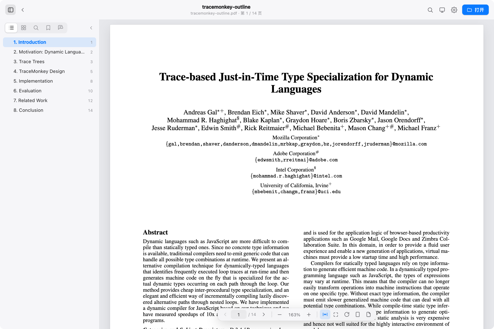
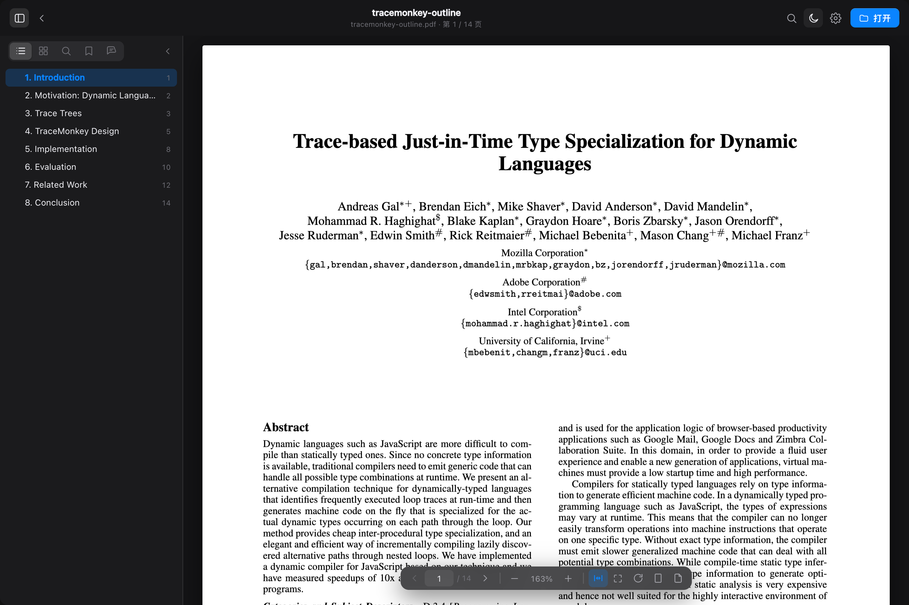

# Paper

[](https://github.com/XiaolongZhang-TT/pdf-reader/actions/workflows/ci.yml)
[](https://github.com/XiaolongZhang-TT/pdf-reader/releases/latest)
[](LICENSE)

**中文** · [English](README.en.md)

一个安静、专注、界面精致的跨平台 PDF 阅读器。使用 **Tauri 2 + React + TypeScript + PDF.js** 构建：macOS 上拥有原生的窗口材质与操作手感，同一套代码也可以构建 Windows 与 Linux 版本。

## 截图



| 浅色阅读 | 深色模式 |
| --- | --- |
|  |  |

## 下载

从 [Releases](https://github.com/XiaolongZhang-TT/pdf-reader/releases/latest) 下载对应平台的安装包：

| 平台 | 产物 | 说明 |
| --- | --- | --- |
| macOS 11+（Apple Silicon） | `.dmg` | **未签名/未公证**。首次打开若被拦截：右键 →「打开」，或执行 `xattr -dr com.apple.quarantine /Applications/Paper.app` |
| Windows 10/11（x64） | `.msi` / `-setup.exe` | 未签名；SmartScreen 提示时选择「更多信息」→「仍要运行」 |
| Linux（x64） | `.AppImage` / `.deb` | AppImage 需要先 `chmod +x` |

> 支持状态：macOS 已完成完整验证；Windows / Linux 由 CI 构建并做编译检查，界面使用系统原生窗口边框，欢迎反馈问题。
>
> 每个 Release 附带对应平台的 `checksums-*.txt`（SHA-256），可用于校验下载文件。

## 功能

**阅读**

- 连续滚动 / 单页两种视图，缩放（适合宽度、适合页面、实际大小、自由缩放）、90° 旋转
- 页面配色：原始白纸 / 护眼米色 / 夜间反色；浅色 / 深色 / 跟随系统外观
- 自动记住每份文档的阅读位置，启动时可继续上次阅读
- 目录（多级大纲）、缩略图、全文搜索（上下文片段 + 精确命中高亮）、书签、标注五个侧边面板
- 最近打开列表（带首页缩略图封面）、拖拽打开、双击 PDF 由 Paper 打开
- PDF 密码输入、文档元数据读取、页码标签（罗马数字等）

**标注**

- 选中文字后可高亮（6 种颜色）、加下划线、删除线、便签备注
- 标注与文档指纹绑定，本地持久化；移动文件位置也不会丢失
- 侧边栏集中管理全部标注，可跳转、改色、补充备注、删除
- `⌘/Ctrl+Z` 撤销最近一次标注操作

**界面与交互**

- macOS：半透明侧边栏（vibrancy）、悬浮玻璃工具栏、透明标题栏
- Windows / Linux：使用系统原生窗口边框
- 原生菜单、键盘快捷键、全屏、无障碍标签
- **纯本地运行**：不发送文档、不上报遥测

## 开发

### 环境要求

- Node.js ≥ 22.12 + pnpm 12（`brew install node pnpm`，或 `corepack enable`）
- Rust stable（[rustup](https://rustup.rs/)，版本由 `rust-toolchain.toml` 固定）
- macOS：Xcode Command Line Tools
- Windows：WebView2 Runtime + C++ build tools
- Linux：`libwebkit2gtk-4.1-dev libappindicator3-dev librsvg2-dev patchelf libgtk-3-dev`

```bash
pnpm install
pnpm tauri dev      # 桌面应用（自动拉起 Vite）
pnpm dev            # 浏览器预览（通过文件选择器打开 PDF）
```

### 测试与检查

```bash
pnpm typecheck      # TypeScript
pnpm test           # Vitest 单元测试
pnpm build          # 类型检查 + 前端构建
cargo fmt --manifest-path src-tauri/Cargo.toml --all -- --check
cargo clippy --manifest-path src-tauri/Cargo.toml --all-targets -- -D warnings
```

CI 会在每次 PR 上运行以上检查，并在 macOS / Windows 上做编译检查。

### 构建安装包

```bash
pnpm tauri build
```

各平台产物位于 `src-tauri/target/release/bundle/`：

- macOS：`macos/Paper.app`、`dmg/Paper_0.1.0_aarch64.dmg`
- Windows：`msi/`、`nsis/`
- Linux：`deb/`、`appimage/`

平台相关的窗口与打包配置分别位于：

```text
src-tauri/tauri.conf.json          共享配置（窗口尺寸、CSP、文件关联、图标）
src-tauri/tauri.macos.conf.json    macOS 透明标题栏 / vibrancy / dmg
src-tauri/tauri.windows.conf.json  Windows msi / nsis
src-tauri/tauri.linux.conf.json    Linux deb / appimage
```

macOS 构建为 ad-hoc 签名（未使用 Apple Developer ID），因此发布包会被 Gatekeeper 提示；这是有意为之，详见 [SECURITY.md](SECURITY.md)。

### 工具链

Rust 使用 rustup 全局安装；Node/pnpm 使用系统安装（Homebrew）。`scripts/env.sh` 会加载 `~/.cargo/env` 并检查依赖，供 `scripts/dev.sh` / `scripts/build.sh` 使用。

## 快捷键

macOS 使用 `⌘`，Windows/Linux 使用 `Ctrl`；`⌥/Alt` 同理。

| 快捷键 | 操作 |
| --- | --- |
| `⌘/Ctrl+O` | 打开 PDF |
| `⌘/Ctrl+F` | 全文搜索 |
| `⌘/Ctrl+D` | 添加 / 移除当前页书签 |
| `⌘/Ctrl++` / `⌘/Ctrl+-` | 放大 / 缩小 |
| `⌘/Ctrl+0` | 实际大小 |
| `⌘/Ctrl+9` / `⌘/Ctrl+8` | 适合宽度 / 适合页面 |
| `⌘/Ctrl+Alt+S` | 展开 / 收起侧边栏 |
| `⌘/Ctrl+Shift+W` | 关闭当前文档 |
| `⌘/Ctrl+Z` | 撤销（输入框内为撤销文字） |
| `←` `→` | 上一页 / 下一页 |
| `↑` `↓` | 连续滚动 |
| `PageUp` `PageDown`、`Space` | 整屏滚动 / 翻页 |
| `Home` `End` | 第一页 / 最后一页 |
| `Ctrl+⌘/Ctrl+F` | 切换全屏 |
| `Esc` | 关闭浮层 / 清除搜索 |

## 原生菜单

菜单栏由 Rust 端创建，跨平台使用同一套动作：

- **Paper / 文件**：关于、打开…、关闭文档、关闭窗口、退出
- **编辑**：撤销、拷贝、粘贴、全选
- **显示**：搜索、侧边栏、缩放、适合宽度/页面、旋转、视图切换、外观、页面配色、全屏
- **窗口**：最小化、缩放
- **帮助**：快捷键

## 技术结构

```text
src/
  App.tsx               应用编排：文档、搜索、标注、快捷键
  components/           Viewer / PageView / Sidebar / Toolbar / 浮层组件
  lib/
    pdf.ts              PDF.js 封装（文档、大纲、文本、搜索、缩略图）
    outline.ts          目录扁平化与唯一 active 条目推导
    storage.ts          本地持久化（设置、进度、书签、标注、最近文件）
    platform.ts         Tauri / 浏览器双后端适配
    utils.ts            几何、选区、剪贴板等纯函数
  styles/global.css     设计系统与全部样式
src-tauri/
  src/lib.rs            Rust 端：文件读取、原生菜单、文件打开事件
  tauri.conf.json       共享配置
  tauri.*.conf.json     各平台窗口与打包覆盖
.github/workflows/      CI 与跨平台发布
```

页面渲染要点：

- 画布按 `devicePixelRatio` 渲染，缩放时保持阅读锚点稳定
- 文本层由 PDF.js `TextLayer` 构建；页面旋转通过 CSS 变换与 viewport 坐标互转完成，保证旋转页面上的选择、搜索命中与标注位置正确
- 连续视图只挂载视口附近的页面，滚动时自动回收
- 「适合宽度」以文档中位页宽为基准，并对更宽的横向页逐页自适应，避免裁切
- 目录以 id 跟踪唯一选中项，避免多个目录条目指向同一页时同时高亮

## 数据与隐私

所有数据保存在本机 WebView 的 `localStorage`：

| Key | 内容 |
| --- | --- |
| `paper.settings` | 外观、页面配色、默认视图、启动行为 |
| `paper.recents` | 最近打开的文档与封面 |
| `paper.session` | 上次阅读的文档 |
| `paper.progress.<fingerprint>` | 阅读位置 |
| `paper.bookmarks.<fingerprint>` | 书签 |
| `paper.annotations.<fingerprint>` | 高亮 / 下划线 / 删除线 / 便签 |

`fingerprint` 是 PDF.js 计算的文档指纹，移动或重命名文件后标注仍然有效。Paper 不包含遥测、账号或网络同步功能。

## 已知限制

- 扫描版（纯图片）PDF 没有文本层，无法选择文字或全文搜索
- 暂不支持手写墨迹、PDF 表单填写与签名
- 超大文档（>500 MB）首次解析会占用较多内存
- Windows / Linux 构建尚未经维护者实机长时间验证
- macOS 发布包未签名、未公证

## 参与贡献

欢迎提交 Issue 和 Pull Request！请先阅读 [CONTRIBUTING.md](CONTRIBUTING.md) 与 [CODE_OF_CONDUCT.md](CODE_OF_CONDUCT.md)。

安全问题请通过 [SECURITY.md](SECURITY.md) 中的私密渠道报告。

## 第三方组件

PDF.js、Tauri、React 等组件的许可证与声明见 [THIRD_PARTY_NOTICES.md](THIRD_PARTY_NOTICES.md)。

## License

[MIT](LICENSE) © 2026 Xiaolong Zhang
